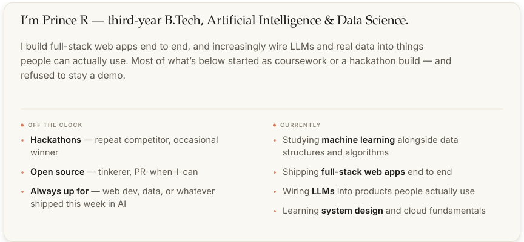
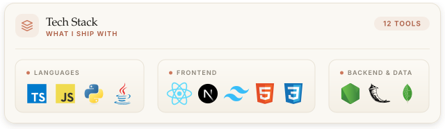
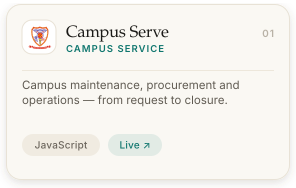
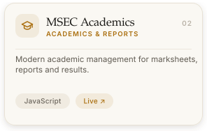
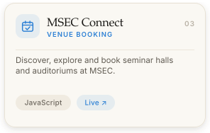
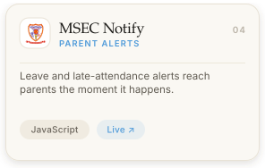
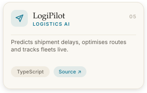
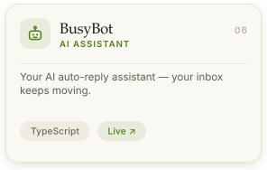
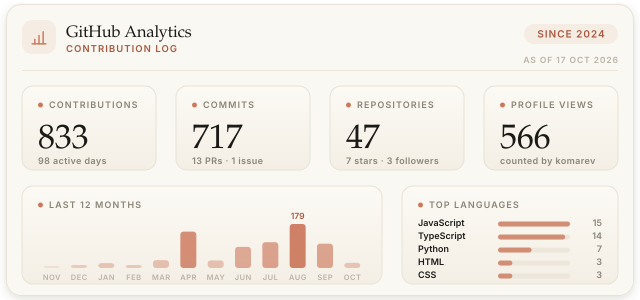

  <picture>
    <source media="(prefers-color-scheme: dark)" srcset="./assets/header.svg" />
    
  </picture>

    

  

    
    
    
    
    
  

 

## 🧑 About

*Third year, still curious, already shipping.*

<!-- about:begin -->

  <picture>
    <source media="(prefers-color-scheme: dark)" srcset="./assets/crest.svg" />
    
  </picture>

<!-- about:end -->

 

## 🛠️ Tech Stack

*What I’m learning on — chosen for shipping, not for résumés.*

<!-- stack:begin -->

  

<!-- stack:end -->

 

<!-- projects:begin -->
## 🚀 Featured Projects

*Things I built for campus and beyond — five of them live.*

    

    

<!-- projects:end -->

 

## 📊 GitHub Analytics

*The graph doesn’t lie.*

<!-- analytics:begin -->

  

<!-- analytics:end -->

  

    
    
    
  

 

## 📫 Let’s Connect

*Open to internships, collaborations, and strong opinions about tabs vs. spaces.*

  
<b>Write to me</b> — <a href="mailto:prince55833kumar@gmail.com">prince55833kumar@gmail.com</a>

  

    
    
    
    
    
  

  
Open to <b>internships</b> and <b>collaborations</b> — anything that puts data or LLMs to real use. If that’s your project, say hello.

   

  Built with care by <a href="https://github.com/princekumar-dev"><b>Prince R</b></a> · Thanks for visiting ⭐

