  

    

  

    
    
    
    
    
  

 

## 🧑 About

*Third year, still curious, already shipping.*

<table>
  <tr>
    <td width="40%" valign="top">
      

        
      

      <h3>⚡ Off the clock</h3>
      <ul>
        <li>🔁 Repeat hackathon competitor &amp; open-source tinkerer</li>
        <li>💬 Happy to talk web dev, data, or whatever shipped this week in AI</li>
      </ul>
    </td>
    <td width="60%" valign="top">
      
<b>I’m Prince R</b> — a third-year B.Tech student in Artificial Intelligence &amp; Data Science.

      

        I build full-stack web apps end to end, and increasingly wire LLMs and real data
        into things people can actually use. Most of what’s below started as coursework
        or a hackathon build and refused to stay a demo.
      

      <h3>🎯 Currently</h3>
      <ul>
        <li>Studying <b>machine learning</b> alongside data structures and algorithms</li>
        <li>Shipping <b>full-stack web apps</b> end to end</li>
        <li>Wiring <b>LLMs</b> into products people actually use</li>
        <li>Learning <b>system design</b> and cloud fundamentals</li>
      </ul>
    </td>
  </tr>
</table>

 

## 🛠️ Tech Stack

*What I’m learning on — chosen for shipping, not for résumés.*

<!-- centred rows, not a table: a full-width table whose icons stop at 40% is a
     bordered box that is 60% empty — and GitHub's table border is what reads as
     a white gutter in light mode. -->

  
<b>Languages</b>    

  
<b>Frontend</b>     

  
<b>Backend &amp; Data</b>   

 

<!-- projects:begin -->
## 🚀 Featured Projects

*Things I built for campus and beyond — five of them live.*

<table>
  <tr>
    <td width="33%" align="center" valign="top"><a href="https://github.com/princekumar-dev/Campus-servre--2">source ↗</a></td>
    <td width="33%" align="center" valign="top"><a href="https://github.com/princekumar-dev/Academics--2">source ↗</a></td>
    <td width="33%" align="center" valign="top"><a href="https://github.com/princekumar-dev/Connect">source ↗</a></td>
  </tr>
  <tr>
    <td width="33%" align="center" valign="top"><a href="https://github.com/princekumar-dev/MSEC-Notify">source ↗</a></td>
    <td width="33%" align="center" valign="top"><a href="https://github.com/princekumar-dev/Logipilot">source ↗</a></td>
    <td width="33%" align="center" valign="top"><a href="https://github.com/princekumar-dev/Busy_Bot">source ↗</a></td>
  </tr>
</table>
<!-- projects:end -->

 

## 📊 GitHub Analytics

*The graph doesn’t lie.*

  <!-- two cards on one line rather than a table: GitHub's table style adds a
       bordered cell around them, which in light mode reads as white gutters. -->
  
 

   

  

    

  

    

  

    
    
    
    
  

 

## 📫 Let’s Connect

*Open to internships, collaborations, and strong opinions about tabs vs. spaces.*

  
<b>Write to me</b> — <a href="mailto:prince55833kumar@gmail.com">prince55833kumar@gmail.com</a>

  

    
    
    
    
    
  

  
Open to <b>internships</b> and <b>collaborations</b> — anything that puts data or LLMs to real use. If that’s your project, say hello.

   

  Built with care by <a href="https://github.com/princekumar-dev"><b>Prince R</b></a> · Thanks for visiting ⭐

